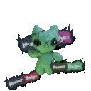

<!-- prettier-ignore -->
<div align="center">



# Hermit Badges Generator

**HTTP service that renders frame-based badges to PNG or WebP.**

[](https://github.com/AshenHermit/hermit-badges-generator/actions/workflows/deploy.yml)
[](https://nodejs.org)
[](https://nestjs.com)
[](https://pnpm.io)

[Overview](#overview) • [Features](#features) • [Quick start](#quick-start) • [API](#api) • [Configuration](#configuration) • [Tests](#tests) • [Deployment](#deployment)

⭐ Star the repo if you find it useful.

</div>

## Overview

Monorepo for the Hermit badges generator. The [`backend/`](backend/README.md) package is a NestJS service that turns parameterized text and colors into a framed badge image. Each template lives in `backend/assets/templates/<id>/` with a `template.html` (HTML/CSS/JS, inline SVG frame) and a `manifest.json` describing its replaceable variables, types, required flags, and defaults. Headless Chromium (`playwright-core`) loads the template locally over `file://` and screenshots the badge element; `sharp` resizes the screenshot to the requested height and encodes PNG or WebP. No network fetch is performed — the font is a local asset.

> [!NOTE]
> Add or edit variables in the template's `manifest.json`. The query parameters accepted by `/api/v1/generate` are defined by that manifest, and clients can discover them through `GET /api/v1/templates/:id`.

## Features

- **Frame badge rendering** — inline SVG frame with separately styled left and right halves; frame and text colors are query parameters.
- **Manifest-driven templates** — declare variables with type (`string`, `color`, `integer`, `select`), required flag, default value, and constraints; unknown query parameters are rejected. `select` parameters expose `options` with `value` and `label`; the value is submitted, the label is displayed.
- **Template metadata API** — list template ids and fetch their parameter definitions.
- **PNG and WebP output** — resized to any height from 1 to 1000 pixels, preserving aspect ratio.
- **Strict input handling** — 1–32 printable characters per half, HTML-escaped before insertion into the template.
- **Deterministic, cached responses** — identical requests are byte-identical, keyed by SHA-256 over the endpoint and sorted query parameters.
- **Two cache drivers** — bounded in-memory cache for development, shared Redis cache for production.
- **Self-describing API** — Swagger UI and OpenAPI JSON, plus a liveness endpoint.
- **Containerized deployment** — prebuilt GHCR images, an immutable `sha-<short>` tag per release, and a documented rollback path.

## Quick start

Prerequisites:

- Node.js 22.22.2 or newer (frontend test tooling: `jsdom@31` / `undici@8`; backend's pinned `sharp@0.35.5` only needs 20.9.0)
- pnpm 10.12.1 (enable with `corepack enable`)
- Playwright Chromium: `pnpm --dir backend exec playwright-core install chromium` (the executable path is resolved at runtime, not hardcoded)

```bash
git clone https://github.com/AshenHermit/hermit-badges-generator.git
cd hermit-badges-generator
corepack enable
pnpm install --frozen-lockfile
pnpm backend:dev
```

The service listens on port `3000` by default. Generate a badge:

```bash
curl -o badge.png 'http://localhost:3000/api/v1/generate?left=Hello&right=World'
```

Interactive API docs: [http://localhost:3000/api/docs](http://localhost:3000/api/docs).

> [!TIP]
> To run compiled output instead of dev mode: `pnpm backend:build && pnpm backend:serve`. All root scripts are Nx targets; see [`backend/project.json`](backend/project.json).

### Frontend

The single-page frontend lives in [`frontend/`](frontend/) and runs on port `3001`:

```bash
pnpm frontend:dev
```

It discovers templates and their parameters through the backend API. Browser metadata requests use relative `/api/v1/...` paths; Next.js rewrites proxy them to `NEXT_PUBLIC_API_BASE_URL` (default `http://localhost:3000`, see [`frontend/.env.local.example`](frontend/.env.local.example)). Set that variable to target another backend, e.g. the production API. The backend has no CORS headers, so keep using the proxy for metadata.

## API

### `GET /api/v1/generate`

Only `template`, `format`, and `height` are fixed parameters. All other query parameters come from the chosen template's manifest (see below).

| Parameter  | Required | Default        | Notes                                    |
| ---------- | -------- | -------------- | ---------------------------------------- |
| `template` | no       | `hermit-frame` | Template id; must have a `manifest.json` |
| `format`   | no       | `png`          | `png` or `webp`                          |
| `height`   | no       | `60`           | Integer 1–1000, output height in pixels  |

For `hermit-frame`, the manifest declares these variables:

| Name           | Required | Default              | Type   | Notes                                      |
| -------------- | -------- | -------------------- | ------ | ------------------------------------------ |
| `left`         | yes      | —                    | string | Left-half text, 1–32 printable characters  |
| `right`        | yes      | —                    | string | Right-half text, 1–32 printable characters |
| `borderColor`  | no       | `rgb(41, 39, 45)`    | color  | Frame border                               |
| `leftBgColor`  | no       | `rgb(53, 52, 62)`    | color  | Left frame fill                            |
| `rightBgColor` | no       | `rgb(140, 48, 101)`  | color  | Right frame fill                           |
| `textColor`    | no       | `rgb(232, 230, 223)` | color  | Badge text (`#e8e6df`)                     |

Colors accept `#RGB`, `#RRGGBB`, or `rgb(r, g, b)` (channels 0–255); they are normalized to `rgb(r, g, b)`. Named colors such as `white` are not accepted. Unknown query parameters and invalid values return `400`.

```bash
# PNG at the default height
curl -o badge.png 'http://localhost:3000/api/v1/generate?left=Hello&right=World'

# Colored badge, WebP at 120 px tall
curl -o badge.webp 'http://localhost:3000/api/v1/generate?left=Hello&right=World&borderColor=%23ff0000&textColor=%2300ff00&format=webp&height=120'
```

Success returns the image bytes with `Content-Type: image/png` or `image/webp` and `Cache-Control: public, max-age=3600`.

### `GET /api/v1/templates`

Returns the sorted list of available template ids, e.g. `["hermit-frame"]`.

### `GET /api/v1/templates/:id`

Returns metadata for one template: `{ "id": "hermit-frame", "parameters": [{ "name": "left", "placeholder": "LEFT", "type": "string", "required": true, ... }] }`. Use this to discover which query parameters `/api/v1/generate` accepts for a given template. Unknown ids return `400`.

> [!IMPORTANT]
> Cached results skip rendering entirely. Set `CACHE_DISABLED=true` to disable reads and writes, or `FRESH_TEMPLATE=true` to re-read the template and manifest on every generation and bypass cached images (`FRESH_MANIFEST` is an alias). Both flags are read at startup and accept `1`, `true`, or `yes` (case-insensitive).

| Endpoint                | Purpose                               |
| ----------------------- | ------------------------------------- |
| `/api/v1/generate`      | Render a badge image                  |
| `/api/v1/templates`     | List template ids                     |
| `/api/v1/templates/:id` | Get a template's query parameters     |
| `/api/health`           | Liveness probe — `{ "status": "ok" }` |
| `/api/docs`             | Swagger UI                            |
| `/api/docs/json`        | OpenAPI 3.0.3 document                |

## Configuration

Local development defaults live in [`backend/.env.example`](backend/.env.example); copy to `backend/.env` and adjust. Production values live in the root [`.env.example`](.env.example); copy to `.env` on the host.

### Backend

| Variable            | Default     | Purpose                                                 |
| ------------------- | ----------- | ------------------------------------------------------- |
| `PORT`              | `3000`      | HTTP listen port                                        |
| `CACHE_DRIVER`      | `memory`    | `memory` or `redis`                                     |
| `CACHE_TTL_MS`      | `3600000`   | Entry TTL; Redis TTL is `ceil(ms / 1000)` seconds       |
| `CACHE_MAX_ENTRIES` | `1000`      | Memory driver only                                      |
| `CACHE_DISABLED`    | `false`     | No cache reads/writes when truthy (`1`, `true`, `yes`)  |
| `FRESH_TEMPLATE`    | `false`     | Re-read template and manifest, bypass cache when truthy |
| `FRESH_MANIFEST`    | —           | Alias of `FRESH_TEMPLATE`                               |
| `REDIS_HOST`        | `127.0.0.1` | Redis host (compose overrides with the service name)    |
| `REDIS_PORT`        | `6379`      | Redis port                                              |
| `REDIS_PASSWORD`    | `change-me` | Redis `requirepass` and client auth                     |
| `REDIS_DB`          | `0`         | Redis database index                                    |

### Production stack

| Variable            | Default                      | Purpose                                            |
| ------------------- | ---------------------------- | -------------------------------------------------- |
| `REDIS_PASSWORD`    | required                     | Redis server password and backend/healthcheck auth |
| `COMMON_DOMAIN`     | required                     | Domain part of the Caddy site address              |
| `SERVICE_SUBDOMAIN` | `badges`                     | Subdomain part of the Caddy site address           |
| `CADDY_PORT`        | `8080`                       | Host port mapped to Caddy port 80                  |
| `BACKEND_IMAGE`     | `ghcr.io/.../backend:latest` | Backend image reference                            |
| `CADDY_IMAGE`       | `ghcr.io/.../caddy:latest`   | Caddy image reference                              |

> [!WARNING]
> `REDIS_PASSWORD` is passed unquoted to `redis-server --requirepass`, so use a single token without whitespace or shell metacharacters (letters, digits, `-`, `_` are safe). Never commit `.env` or credentials. An empty password is rejected by the deploy preflight before the stack is touched.

## Project layout

```text
backend/                     NestJS service
  assets/templates/<id>/     Template HTML/CSS/JS and its manifest
  assets/fonts/              Bundled fonts
  src/templates/             Manifest loading and query-parameter validation
  src/                       Generation, rendering, cache, and health modules
  test/                      Unit, e2e, and golden-image tests
.github/workflows/deploy.yml Verify → build → deploy pipeline
scripts/deploy-remote.sh     Host-side deploy (pull images, recreate stack)
Dockerfile                   backend-prod and caddy-prod image targets
docker-compose.prod.yml      Production stack: Redis, backend, Caddy
Caddyfile.template           Reverse-proxy site address template
caddy-entrypoint.sh          Renders the Caddyfile from env at startup
```

## Tests

```bash
pnpm backend:test
pnpm backend:test:e2e
```

> [!NOTE]
> Run the unit suite serially (`cd backend && npm test -- --runInBand`): `template.service.spec.ts` temporarily rewrites `template.html` and restores the original bytes in `finally`. Run e2e with `CACHE_DISABLED=false` and `FRESH_MANIFEST=false` so cache-separation assertions are exercised.

`src/generation/golden.spec.ts` compares rendered bytes against a checked-in PNG. Regenerate it only with the toolchain recorded in [`backend/test/golden/README.md`](backend/test/golden/README.md); OS, Node, Playwright, or Chromium changes can alter PNG bytes.

## Deployment

The production stack runs three containers: `redis` (internal cache with append-only persistence), `backend` (GHCR image, starts after Redis is healthy), and `caddy` (reverse proxy on `<SERVICE_SUBDOMAIN>.<COMMON_DOMAIN>`, starts after the backend is healthy). TLS is terminated by an external proxy; Caddy serves plain HTTP. The site is published on `${CADDY_PORT:-8080}:80`. See [`DEPLOY.md`](DEPLOY.md) for the full environment contract and host requirements.

`.github/workflows/deploy.yml` runs on a push to `master` or via `workflow_dispatch` (with an optional `ref`, used for rollbacks):

1. **verify** — install, run unit tests, build.
2. **build** — push `backend-prod` and `caddy-prod` images to GHCR with immutable `sha-<short>` tags plus `latest`.
3. **deploy** — validate env locally, write `.env` on the host, copy the compose file, and run `scripts/deploy-remote.sh` over SSH. The host only pulls images and recreates the stack; it never builds.

> [!WARNING]
> The external `shared-net` Docker network must exist on the host. Repository secrets `SSH_PRIVATE_KEY` and `PROD_ENV` are required; the first deploy creates `/home/hermit-badges-generator` with no data migration.

Rollback: rerun the workflow with `ref` set to an older commit, or on the host point `BACKEND_IMAGE` and `CADDY_IMAGE` in `.env` at a previous `sha-<short>` tag and recreate the stack with `docker compose up -d --force-recreate --wait`. Details in [`DEPLOY.md`](DEPLOY.md#rollback).

## Documentation

- [Backend service README](backend/README.md) — template format, local usage, and test notes
- [Production deployment and rollback](DEPLOY.md)
- [Monorepo deploy design](docs/superpowers/specs/2026-11-26-monorepo-deploy-design.md) and [implementation plan](docs/superpowers/plans/2026-11-26-monorepo-deploy.md)
